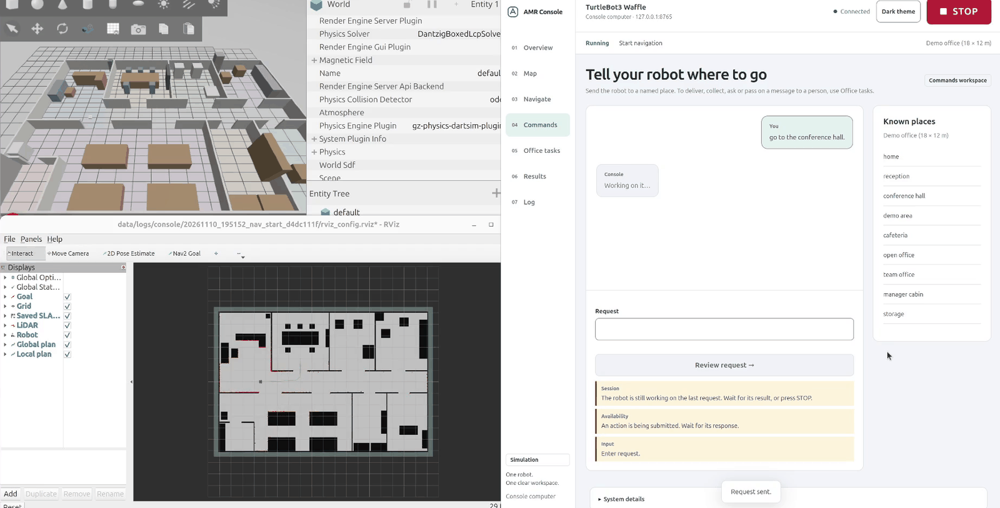
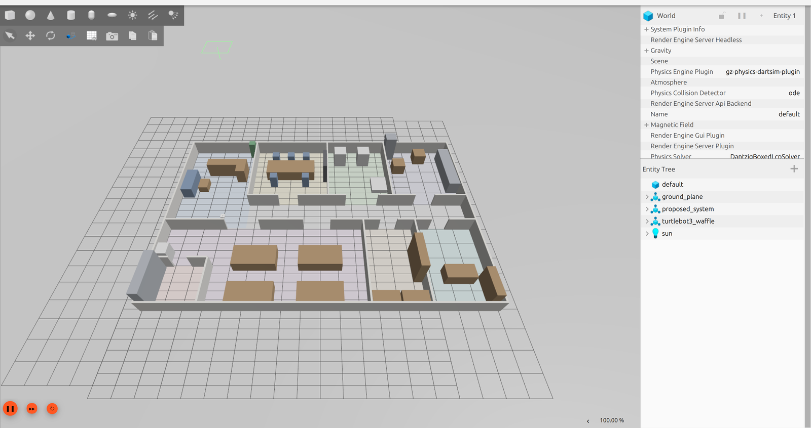
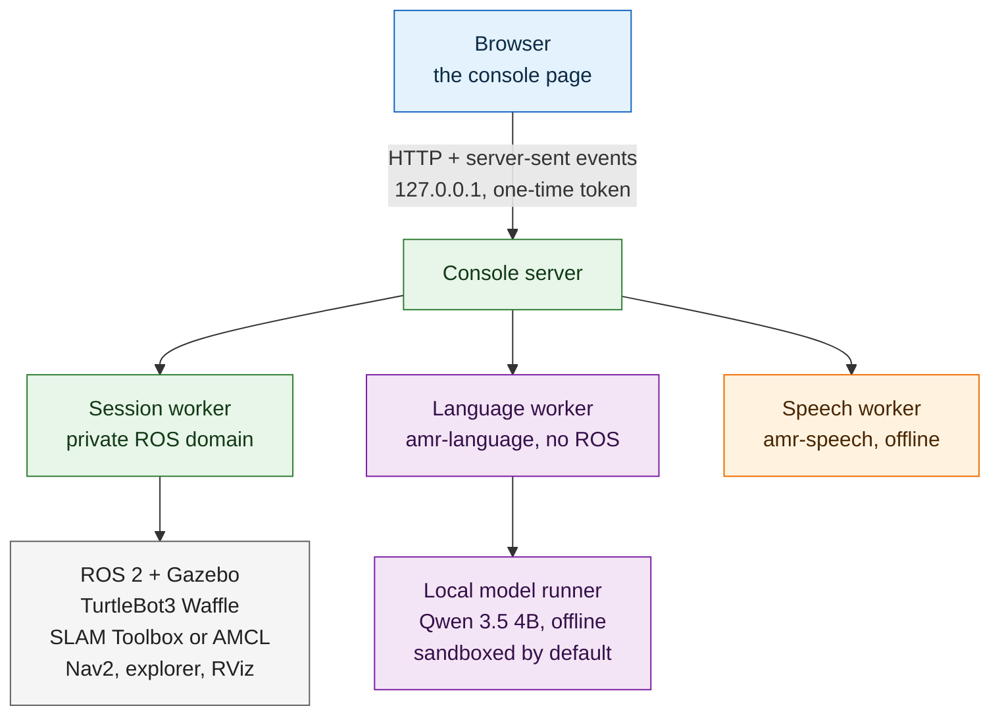

<div align="center">


# AMR Console

### The office robot that asks instead of guessing

Tell it what you need in plain English. It reads your request back, waits for your yes, does the
job, and tells you honestly how it went.

[](https://github.com/SreevanjiManoharan179/AMR_Console/actions/workflows/ci.yml)


</div>


*A recorded run at 4.5× speed. Priya asks the robot to check whether the conference hall is free
and, if it isn't, to try the open office and the cafeteria. The robot reads the request back,
waits for her yes, drives there (RViz, bottom right) and asks. Nobody answers within 20 s, so it
doesn't guess: it reports that the step couldn't be done and heads back to the dock. Simulation,
10 Nov 2026.*

| 🗺️ **98.9 %** | 🏠 **5 of 5** | 🎯 **0 of 98** | 💬 **30 of 30** |
|:---:|:---:|:---:|:---:|
| of the office mapped with nobody steering (median of 5 runs) | exploration runs that ended back at the dock | wrong destinations in an offline test of typed commands | fixed English test requests understood as expected |

> [!NOTE]
> **Simulation only, for now.** A case study finished in November 2026: a TurtleBot3 Waffle in
> Gazebo Harmonic on ROS 2 Jazzy. The console works in English; Tamil and Tanglish can be tried
> on the Speech Lab test page, and its speech checks also cover Malayalam and Telugu. Connecting
> a real robot is planned, not built.

## 💡 Why it exists

Buying a mobile robot is the easy part. Then the questions start. Will it find its way around
*your* floor? Can it map the place without someone steering it? Will it understand "take this to
Divya", and what will it do when Divya isn't at her desk?

AMR Console is the software for those questions. It's a browser console that maps an office,
explores it on its own, navigates with Nav2 and takes everyday requests in plain English. Every
run is recorded, and the records can be checked against the simulator's ground truth. Its one
house rule: when it isn't sure, it asks.

## ✨ What it does

| | |
|---|---|
| 📦 **Runs office errands** | Delivers and collects small items (up to four in one trip), passes on messages, and asks someone a question and brings back the answer. Requests can be typed or spoken and chained: "then", "if yes / if no", "if she is not there". |
| 🙋 **Asks instead of guessing** | Every office request is read back, and nothing moves before a yes. An unclear place gets a question, in typed commands too. A name or place that isn't on the map is never guessed, and anything too heavy or unsafe to carry gets a polite no, with the reason. |
| 🗺️ **Maps on its own** | SLAM Toolbox with a drive pad in the browser, or automatic frontier exploration that maps the office and drives itself back to the dock. |
| 🧭 **Navigates** | Nav2 with MPPI, DWB or RPP on a saved map. Send a goal, or type "go to the cafeteria". |
| 🧾 **Keeps receipts** | Every session saves its command, logs, results and a cleanup audit, with the simulator's ground truth to check them against. |
| 🔒 **Stays on your computer** | The console listens on 127.0.0.1 only, behind a one-time token, and the language and speech models run offline. STOP shuts down everything the console started, in order, and checks that nothing is left running. |
| 🎙️ **Comes with a Speech Lab** | A separate test bench for speech-to-text and for what the language module makes of it, with word, character and key-word scores. |

## 🎬 See it work

Screenshots from 10 Nov 2026, in simulation. The people in the office list are made up.

| | |
|---|---|
| [](docs/images/office-tasks-readback.png) | [](docs/images/navigation-to-conference-hall.png) |
| **Office tasks.** Priya asks for a file to go to Divya, or to come back to her if Divya is away. The robot reads the request back and waits for a yes before it moves. | **Navigation.** "Go to the conference hall": Gazebo (top left), RViz with the saved map, LiDAR and the planned path (bottom left), and the console (right). |
| [](docs/images/commands-clarifying-question.png) | [](docs/images/gazebo-demo-office.png) |
| **Asking instead of guessing.** "Go to the room" is ambiguous, so the console asks "Did you mean the conference hall?" and does not move. | **The demo office.** The 18 × 12 m office world in Gazebo Harmonic, with the TurtleBot3 Waffle. |

[](docs/images/office-people-and-places.png)

*What the robot knows about the office, drawn on its saved map: where each person is served
(orange), the named places (blue) and objects it can approach (green), with a route from the
dock to a seat in the open office. Positions are approximate.*

## 🧠 How it works



<p align="center">🟦 you · 🟩 the console · ⬜ robot and simulator · 🟪 language · 🟧 speech</p>

Each worker is a separate process. The language model is clever, but it never gets the wheels.
Three rules are enforced in code:

| Rule | How it's kept |
|---|---|
| 🤚 **No guess moves the robot** | A question or a refusal never sends a goal, and an office task waits for a yes. |
| 🔑 **The language model never drives** | It can only name an approved place. The console keeps the keys: it checks that stop again on the live map, then sends the goal itself. |
| 🛑 **STOP means stop** | Everything the console started shuts down in order, and an audit checks that nothing survived. |

An office task, step by step:

| | Step | What happens |
|:---:|---|---|
| 1 | **Understand** | The language module turns the request into short steps (six at most) and checks every name and place against the office list and the map. A built-in English grammar handles the requests it knows; the local model rewrites and plans the rest. Everything the robot says comes from fixed, reviewed sentences. |
| 2 | **Read back** | *"I will collect the file from you and take it to Divya. If she is not there, I will bring it back. Is that OK?"* Nothing moves before a yes. |
| 3 | **Drive** | Nav2 takes the robot to each stop on the saved map. |
| 4 | **Ask** | At the stop it waits for "taken", "not here" or an answer. If nobody answers, the request's own rule applies; by default the item comes back. |
| 5 | **Report and return** | The person who asked is told how each step went. With nothing left to do, the robot goes back to the dock. |

Someone it doesn't know, or a place that isn't on the map? It asks where the person sits, whether
they're in today, or which mapped place is meant, and the answer becomes a new step that needs a
new yes. More in [OFFICE_TASKS.md](amr-console-dev/docs/OFFICE_TASKS.md),
[SCENARIOS.md](amr-console-dev/docs/SCENARIOS.md) and
[ARCHITECTURE.md](amr-console-dev/docs/ARCHITECTURE.md).

## 📏 What's been measured

All in simulation. Each result links to its full table and its limits.

| What | Result | Details |
|---|---|---|
| Automatic exploration of the 18 × 12 m office, 5 runs per method | method `ours`: **98.9 %** of the floor mapped (median), back at the dock **5 of 5**, no collisions | [console README](amr-console-dev/README.md#exploration-benchmark-in-simulation) |
| Typed delivery commands, offline, 98 test commands generated from templates | wrong destinations **15.3 %** when acting on the top guess, **0 %** with conformal sets and questions (95 % upper bound 3.8 %); it asked to clarify 29 % of them | [pilot results](amr-console-dev/config/calibration/proposed_system/tasks/results.md) |
| Office requests in English, with the real language model | **30 of 30** fixed test requests understood as expected (10 Nov 2026, typed, no robot) | [language README](amr-language/README.md#how-it-has-been-checked) |
| Offline test suites (no simulator, stand-in model) | console: **701** pass; language module: **476** pass, 8 skipped here (below) | [CI](.github/workflows/ci.yml) |

**Honest limits.**

- **No real robot yet.** Everything above ran in Gazebo. The simulated LiDAR sees 20 m and a real
  TurtleBot3's about 3.5 m, so expect lower numbers on hardware.
- **Test sentences, not real people.** The language checks use fixed and template sentences, typed.
  The typed-command test assumes a person who always answers truthfully.
- **English in the console.** Other languages are only on the Speech Lab bench, and their wording
  hasn't been checked by native speakers.
- **Carrying limits are placeholders.** The tray size, payload and allowed items are proposals for
  the simulated robot, not measured limits.

The run logs, maps over time and model outputs behind these results aren't in this repository;
the author can share them on request. Eight language-module tests check those records, so here
they're skipped. Everything that drives the robot is checked live in the simulator, not by these
suites.

## 🚀 Try it

> [!IMPORTANT]
> The source is published to be read and reviewed. Building or running it needs the copyright
> holder's written permission; see [LICENSE](LICENSE).

You need Ubuntu 24.04 with ROS 2 Jazzy and Gazebo Harmonic; [docs/INSTALL.md](docs/INSTALL.md)
lists everything, in order.

```bash
git clone https://github.com/SreevanjiManoharan179/AMR_Console.git
cd AMR_Console/amr-console-dev
bash setup/check_system.sh        # what is installed, what is missing (installs nothing)
bash setup/build.sh               # colcon build of the robot package
bash scripts/check.sh             # offline tests (no simulator)
bash setup/run_console.sh         # starts the console and opens it in your browser
```

Mapping, exploration and navigation work straight away. Office tasks also need the local model
runner and model, and speaking needs the speech install; both are in
[docs/INSTALL.md](docs/INSTALL.md). The simulated office's named places come with the owner's
approvals (`amr-console-dev/tools/amr_console/approvals.yaml`); a new world starts unapproved, and
the console never edits approvals.

## 🗂️ What's inside

```text
AMR_Console/
├── amr-console-dev/   the product: browser console, ROS 2 package, task layer, Speech Lab
├── amr-language/      the language module, which the console starts as its own process
├── docs/              the install guide and the images in this README
├── release/           rebuilds this repository from development, with privacy and size checks
└── .github/           CI and Dependabot
```

The speech install adds a third folder, `amr-speech/`, on your computer: its Python environment
and downloaded models, no source code. The console looks for `../amr-language` and
`../amr-speech` next to itself, so keep the three folders side by side.

| Start here | For |
|---|---|
| [amr-console-dev/README.md](amr-console-dev/README.md) | the console: using it, worlds, exploration benchmark, layout |
| [amr-console-dev/docs/SCENARIOS.md](amr-console-dev/docs/SCENARIOS.md) | what the robot does in each office situation |
| [amr-language/README.md](amr-language/README.md) | the language module and how it has been checked |
| [docs/INSTALL.md](docs/INSTALL.md) | everything to install, in order, and how to check each part |
| [amr-console-dev/docs/SPEECH_INSTALL_REQUEST.md](amr-console-dev/docs/SPEECH_INSTALL_REQUEST.md) | the speech-to-text install |
| [CHANGELOG.md](CHANGELOG.md) · [CONTRIBUTING.md](CONTRIBUTING.md) · [SECURITY.md](SECURITY.md) | what changed; how changes are checked; how to report a security problem |

## 📄 Paper

A paper about this work is under review. Its citation will appear here once the review is over.

## 🙏 Built on

AMR Console stands on a lot of open-source work: [ROS 2](https://docs.ros.org/en/jazzy/),
[Nav2](https://github.com/ros-navigation/navigation2),
[SLAM Toolbox](https://github.com/SteveMacenski/slam_toolbox), [Gazebo](https://gazebosim.org/),
the [TurtleBot3 simulation](https://github.com/ros-navigation/nav2_minimal_turtlebot_simulation),
[Ollama](https://github.com/ollama/ollama) running [Qwen 3.5](https://huggingface.co/Qwen/Qwen3.5-4B),
[faster-whisper](https://github.com/SYSTRAN/faster-whisper), and AI4Bharat's
[IndicConformer](https://huggingface.co/ai4bharat/indic-conformer-600m-multilingual) and
[IndicTrans2](https://github.com/AI4Bharat/IndicTrans2). Thank you to everyone who builds and
looks after them. Their licences are listed in [THIRD_PARTY_LICENSES.md](THIRD_PARTY_LICENSES.md).

## 📜 Licence

Copyright (c) 2026 Bharathwaj Manoharan. All rights reserved: the source is published so that it
can be read and reviewed. No licence to use, copy, modify or distribute it is granted without the
copyright holder's prior written permission; see [LICENSE](LICENSE). Third-party software used at
run time, and the few files derived from it, are listed in [NOTICE](NOTICE) and
[THIRD_PARTY_LICENSES.md](THIRD_PARTY_LICENSES.md). No model weights are included.

To cite the software, use [CITATION.cff](CITATION.cff) (GitHub's "Cite this repository" button).
