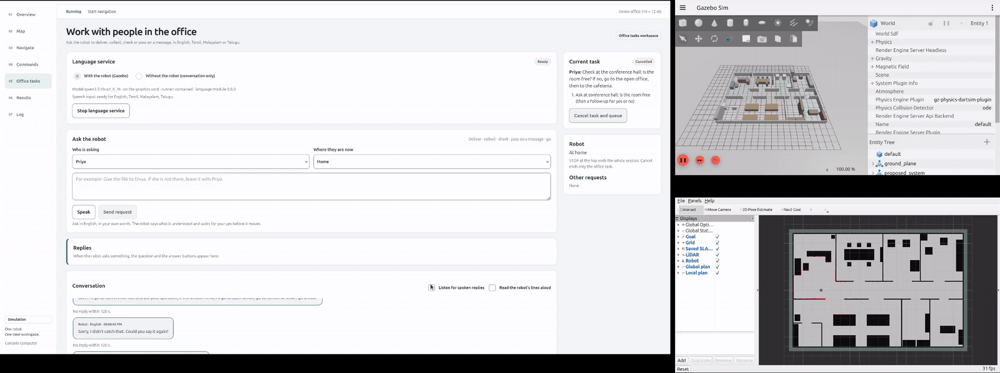
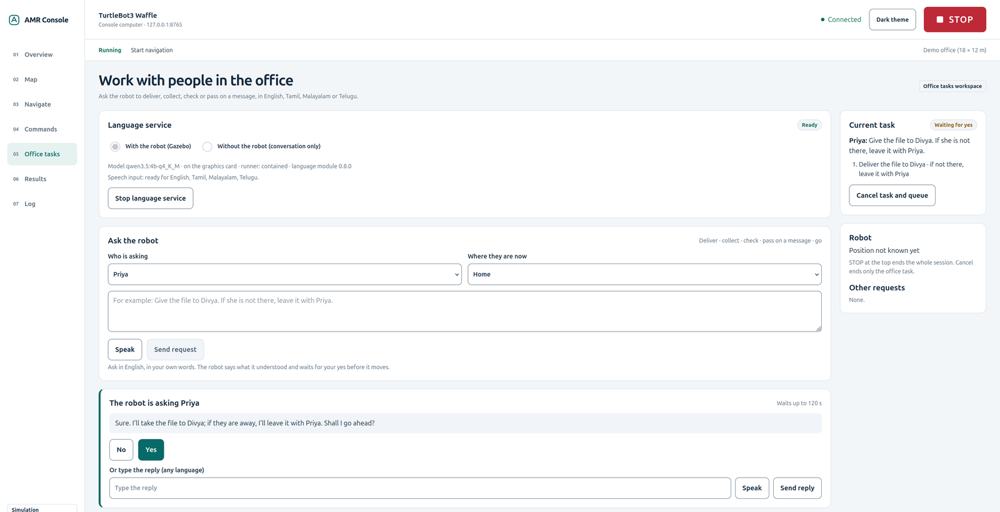
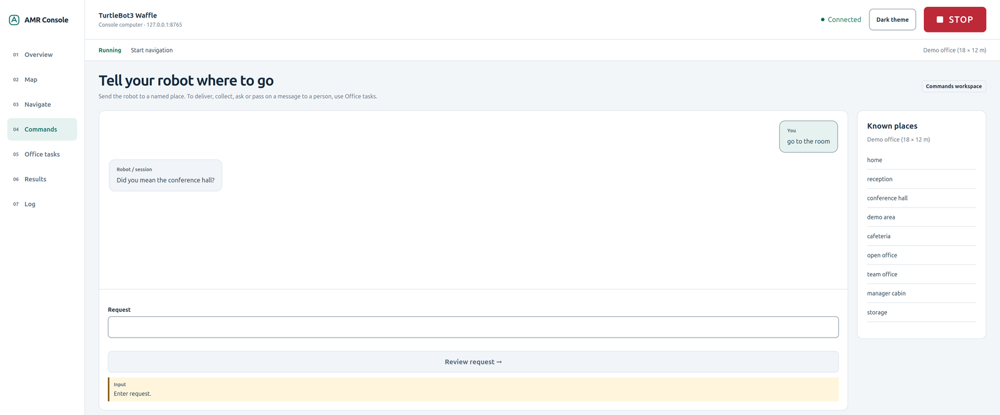
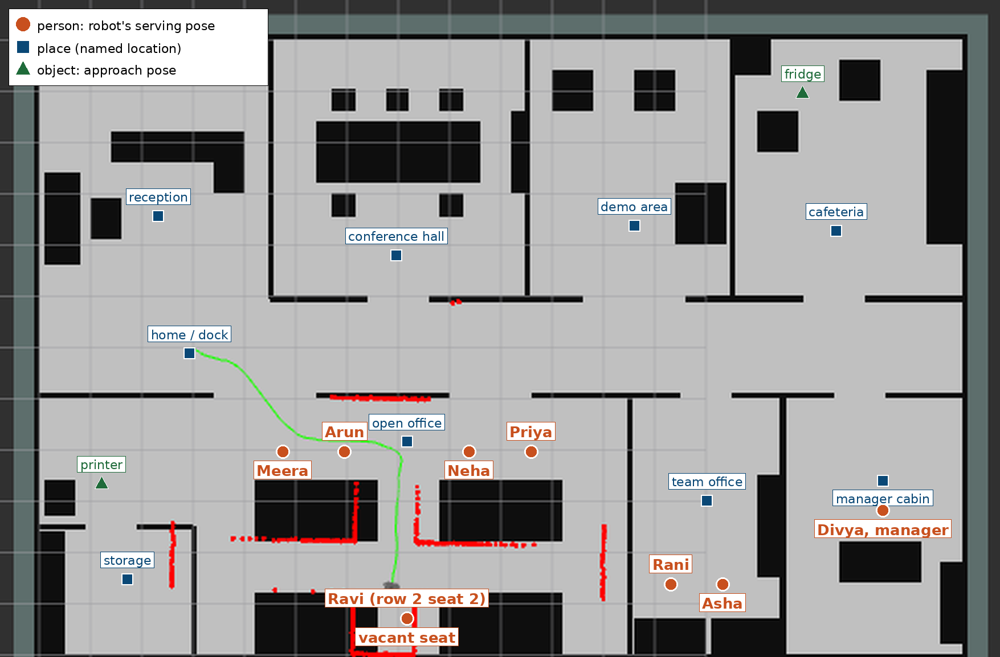
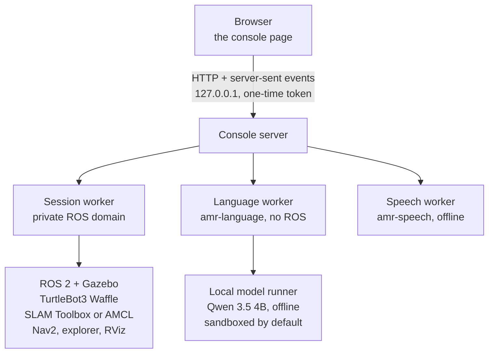

# AMR Console

[](https://github.com/SreevanjiManoharan179/AMR_Console/actions/workflows/ci.yml)


An office assistant for an autonomous mobile robot, in simulation: people ask in plain English,
the robot says what it understood, waits for a yes, and carries small items and messages between
them. The same browser console maps a building, explores it automatically, navigates with Nav2
and records every run against the simulator's ground truth.

> **Status:** case study completed in November 2026. Simulation only, with the TurtleBot3 Waffle
> reference robot in Gazebo Harmonic on ROS 2 Jazzy. English in the console; Tamil and Tanglish
> on the Speech Lab test page, and Malayalam and Telugu in its speech checks. A real-robot
> connection is planned, not built.



*An office task end to end, at 4.5× speed. Priya asks the robot to check whether the conference
hall is free and, if it is not, to go on to the open office and the cafeteria. The robot reads
the request back and waits for her yes, drives to the conference hall (RViz, bottom right) and
asks there. Nobody answers within 20 s, so it does not guess: it reports that the step could not
be done and returns to the dock. Recorded 10 Nov 2026, in simulation.*

## What it does

- **Office tasks.** Delivers and collects small items (up to four in one trip), passes on
  messages, asks someone a question and brings back the answer, and goes to people or places.
  Requests are typed or spoken in plain English and can be chained: "then", "if yes / if no",
  "if she is not there".
- **Asks instead of guessing.** An office request is read back, and nothing moves before a yes.
  An unclear place gets a question, in typed commands too; a name or place that is not on the map
  is never guessed; and an item that is too heavy or unsafe to carry is refused with the reason.
- **Mapping and automatic exploration.** SLAM Toolbox with a drive pad in the browser, or one of
  three frontier-exploration methods that map the office on their own and return to the dock.
- **Navigation.** Nav2 with MPPI, DWB or RPP on a saved map; goals and typed commands such as
  "go to the cafeteria" from the browser.
- **Records.** Every session keeps its command, logs, results and a cleanup audit, checked
  against the simulator's ground truth; exploration runs are scored against the exact map.
- **Local and contained.** The console serves 127.0.0.1 only, behind a one-time token, and the
  language and speech models run offline on the same computer. STOP ends everything the console
  started, in order, and checks that nothing survived.
- **Speech Lab.** A separate test bench, without the robot, for speech-to-text and for what the
  language module makes of it, with word, character and key-word scores.

## In action

Screenshots from 10 Nov 2026, in simulation. The people in the office list are fictional.

| | |
|---|---|
| [](docs/images/office-tasks-readback.png) | [](docs/images/navigation-to-conference-hall.png) |
| **Office tasks.** Priya asks for a file to go to Divya, or to come back to her if Divya is away. The robot reads the request back and waits for a yes before it moves. | **Navigation.** "Go to the conference hall": Gazebo (top left), RViz with the saved map, LiDAR and the planned path (bottom left), and the console (right). |
| [](docs/images/commands-clarifying-question.png) | [](docs/images/gazebo-demo-office.png) |
| **Asking instead of guessing.** "Go to the room" is ambiguous, so the console asks "Did you mean the conference hall?" and does not move. | **The demo office.** The 18 × 12 m office world in Gazebo Harmonic, with the TurtleBot3 Waffle. |

[](docs/images/office-people-and-places.png)

*What the robot knows about the office, drawn on its saved map: where each person is served
(orange), the named places (blue) and objects it can approach (green), with a route from the
dock to a seat in the open office. Positions are approximate.*

## How it works



The workers are separate processes. The console, not the language module, moves the robot,
handles STOP and checks the owner's approvals:

- The **session worker** starts one ROS 2 launch on a private ROS domain and Gazebo partition,
  runs the operations (save a map, send a goal, a typed command) and, on STOP, shuts everything
  down in order and audits that nothing it started survives.
- The **language worker** understands requests and holds the conversation, but never drives:
  each move it asks for names an approved place, and the console checks that stop again on the
  live map just before it sends the goal.
- The **speech worker** writes down recordings of up to 15 s. A person checks the words and
  presses Send; nothing spoken is acted on directly.

An office task, step by step:

1. **Understand.** The language module turns the request into at most six short steps and checks
   every name and place against the office list and the map. A built-in English grammar reads
   the requests it covers, and the local model rewrites and plans the others. Everything the
   robot says comes from fixed, reviewed sentences.
2. **Read back and wait for a yes.** "I will collect the file from you and take it to Divya. If
   she is not there, I will bring it back. Is that OK?"
3. **Drive** to each stop with Nav2 on the saved map.
4. **Ask at the stop:** "taken", "not here" or an answer. If nobody answers, the rule in the
   request applies; by default the item comes back.
5. **Report and return.** The person who asked is told how each step went, and with nothing left
   to do the robot returns to the dock.

For a name or place that is not on the map, the robot asks: where the person sits, whether they
are in today, which mapped place is meant. The answer becomes a new step that needs a new yes.
The details are in [OFFICE_TASKS.md](amr-console-dev/docs/OFFICE_TASKS.md),
[SCENARIOS.md](amr-console-dev/docs/SCENARIOS.md) and
[ARCHITECTURE.md](amr-console-dev/docs/ARCHITECTURE.md).

## Two projects, one product

| Folder | What it is | Start here |
|---|---|---|
| [`amr-console-dev/`](amr-console-dev/) | **The product.** The browser console (mapping, exploration, navigation, Office tasks), the ROS 2 package, the delivery-task layer and the Speech Lab test bench | [README](amr-console-dev/README.md), then [SCENARIOS](amr-console-dev/docs/SCENARIOS.md) |
| [`amr-language/`](amr-language/) | The language module the console starts as its own process: understands requests, checks them against the office's people and places, holds the conversation | [README](amr-language/README.md) |
| `amr-speech/` (made on your computer) | Speech-to-text: its Python environment and downloaded models. No source code | [speech install](amr-console-dev/docs/SPEECH_INSTALL_REQUEST.md) |

The console looks for the other two next to itself (`amr-console-dev/config/office_tasks.yaml`:
`../amr-language`, `../amr-speech`), so keep the three folders side by side, as in this
repository.

The rest of the repository: [`docs/`](docs/) holds the installation guide and the images above,
[`release/`](release/) the tool that rebuilds this repository from the development repositories
with its privacy and size checks, and [`.github/`](.github/) the CI and Dependabot settings.

## What has been measured

All in simulation. The full tables, with their limits, are in the project READMEs.

| Check | Result | Where |
|---|---|---|
| Automatic exploration of the 18 × 12 m office, 5 runs per method | method `ours`: 98.9 % of the floor mapped (median), back at the dock 5 of 5, no collisions | [console README](amr-console-dev/README.md#exploration-benchmark-in-simulation) |
| Office request check, English, with the real language model | 30 of 30 fixed test requests understood as expected (10 Nov 2026, typed, no robot) | [language README](amr-language/README.md#how-it-has-been-checked) |
| Offline test suites (no simulator, stand-in model) | console: 701 tests pass; language module: 476 pass, 8 skipped here (below) | [CI](.github/workflows/ci.yml) |

The measurement records behind these results (run logs, maps over time, model outputs) and the
dated development reports are not in this repository; the author can share them on request.
Eight language-module tests check those records, so here they are skipped. Everything that
drives the robot is checked live in the simulator, not by these suites.

## Quick start

Ubuntu 24.04 with ROS 2 Jazzy and Gazebo Harmonic; [docs/INSTALL.md](docs/INSTALL.md) has the
full list and every optional part. Building and running the software needs the copyright
holder's permission (see [Licence](#licence)).

```bash
git clone https://github.com/SreevanjiManoharan179/AMR_Console.git
cd AMR_Console/amr-console-dev
bash setup/check_system.sh        # what is installed, what is missing (installs nothing)
bash setup/build.sh               # colcon build of the robot package
bash scripts/check.sh             # offline tests (no simulator)
bash setup/run_console.sh         # starts the console and opens it in your browser
```

Mapping, exploration and navigation need nothing more. The Office tasks tab also needs the local
model runner and model, and speaking instead of typing needs the speech install
([docs/INSTALL.md](docs/INSTALL.md)). The owner's approvals of the simulated office's named
places are included (`amr-console-dev/tools/amr_console/approvals.yaml`); a new world starts
unapproved, and the console never edits approvals.

## Documents

| Document | What it covers |
|---|---|
| [docs/INSTALL.md](docs/INSTALL.md) | everything to install, in order, and how to check each part |
| [amr-console-dev/docs/README.md](amr-console-dev/docs/README.md) | the console's documents: scenarios, office tasks, architecture, API, worlds, Speech Lab |
| [amr-language/docs/README.md](amr-language/docs/README.md) | the language module's documents: the contract with the console, design, rehearsal rules |
| [CHANGELOG.md](CHANGELOG.md) | what changed in this repository |
| [CONTRIBUTING.md](CONTRIBUTING.md) | how changes are checked; how this repository is updated from development |
| [SECURITY.md](SECURITY.md) | how to report a security problem |

## Licence

Copyright (c) 2026 Bharathwaj Manoharan. All rights reserved: the source is published so that it
can be read and reviewed. No licence to use, copy, modify or distribute it is granted without the
copyright holder's prior written permission; see [LICENSE](LICENSE). Third-party software used at
run time, and the few files derived from it, are listed in [NOTICE](NOTICE) and
[THIRD_PARTY_LICENSES.md](THIRD_PARTY_LICENSES.md). No model weights are included.

To cite this work, see [CITATION.cff](CITATION.cff).
